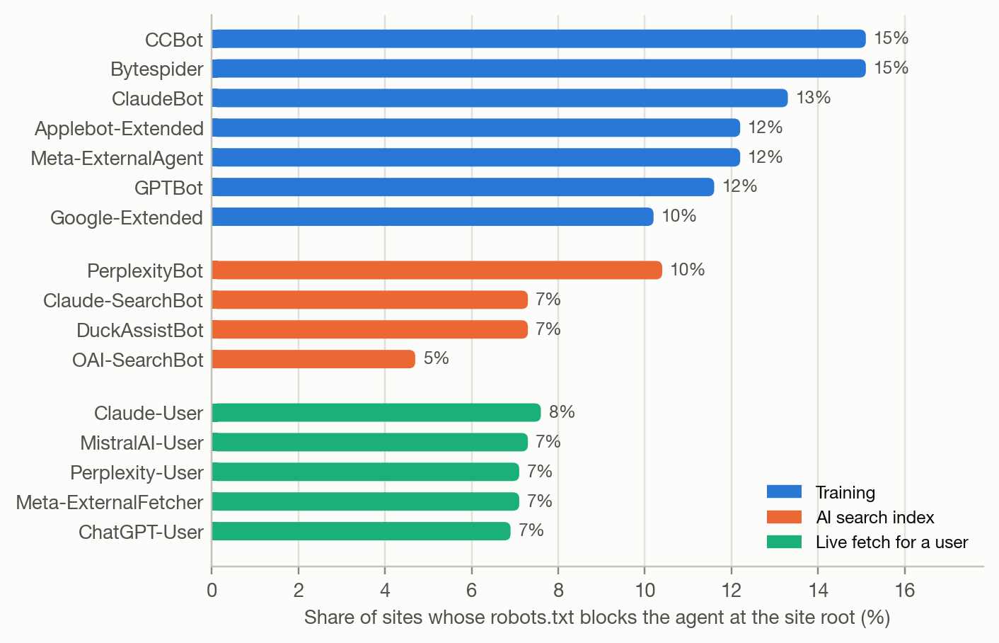

# The AEO Handbook

**Answer Engine Optimization: everything an organisation needs to be found, understood and
cited by ChatGPT, Claude, Gemini, Perplexity, Copilot and Google's AI Overviews, in one
evidence-graded source.**

This repository combines four things:

1. **A practitioner handbook** ([`docs/`](docs/)) covering access, content, entities, earned media,
   measurement, corrections, agents and commerce, ethics and roadmaps. Every technique is
   graded by the strength of its evidence.
2. **Engine-specific guides** ([`engines/`](engines/)) for ChatGPT, Claude, Google AI (AI Overviews,
   AI Mode, Gemini), Perplexity, Copilot and others: crawlers, controls, citation behaviour and
   measurement for each.
3. **Open tools** ([`aeotools/`](aeotools/)): a site audit, an RFC 9309 robots.txt evaluator, an
   AI-bot log analyser and a multi-model visibility tracker.
4. **Original research** ([`experiments/`](experiments/) and [`paper/`](paper/)): a measurement of access
   barriers on 569 organisational websites and 703 randomly sampled popular sites, and a pre-specified
   controlled experiment on content techniques run on 12 hosted models, replicated on 10 more models
   behind widely used assistants (including GPT-6.1 Sol and Claude Sonnet 5.5), with a snapshot audit of
   Perplexity, Gemini and ChatGPT.

## Start here

| If you want to… | Go to |
|---|---|
| Understand AEO in 10 minutes | [What AEO is](docs/01-what-is-aeo.md) → [How answer engines work](docs/02-how-answer-engines-work.md) |
| Check whether AI can read your site | `python -m aeotools.audit yoursite.com --render`, then [Technical access](docs/03-technical-access.md) |
| Know which content tactics actually work | [Content techniques, graded by evidence](docs/04-content-techniques.md) |
| Optimise for a specific engine | [Engine guides](engines/README.md) |
| Measure your AI visibility | [Measurement](docs/07-measurement.md) and `python -m aeotools.tracker` |
| Fix wrong AI answers about you | [Correcting AI answers](docs/08-correcting-ai-answers.md) |
| Get a plan | [90-day roadmap](docs/12-roadmap.md) and [audit checklist](checklists/aeo-audit-checklist.md) |

## The short version

1. **Access first.** Answer engines can't cite what they can't fetch. Allow the *answer*
   crawlers (`OAI-SearchBot`, `ChatGPT-User`, `Claude-SearchBot`, `Claude-User`,
   `PerplexityBot`, `Googlebot`, `Bingbot`), decide separately about *training* crawlers, check
   your CDN/WAF, and serve content as HTML. Most barriers we found were accidental: a wildcard
   rule, an unreachable robots.txt, a CDN default or text that only JavaScript produces.
2. **Earn corroboration.** Engines lean on reviews, press, communities and reference sites more
   than on your own pages. In our experiment, one recommendation in a neutral guide did more than
   any edit to the brand's own page.
3. **Rank for the questions engines search.** Engines retrieve through search indexes, so be the
   most relevant source for the real question and the sub-questions they fan out to: pricing,
   comparisons, alternatives, use cases.
4. **Put checkable evidence on your pages.** Specific figures, sources and named evaluations are
   what answers pass on to readers. Don't expect Q&A rewrites or freshness stamps to get you
   named: in our experiment they did nothing.
5. **Measure like a poll:** a fixed prompt set, repeated runs, and intervals around every number.
6. **Don't manipulate.** Hidden instructions worked on the small models we tested, but they deceive
   users and violate search engines' spam policies; keyword stuffing does too. Fake reviews and
   astroturfing are deceptive and a losing game when everyone does them.

## What our research found

**Experiment 1: 569 organisational websites, 22 sectors, November 2026** ([details](experiments/exp1_web_readiness/)):

- **34.6%** of sites have at least one barrier to AI answer engines (**19.0%** if refusals at the
  network edge are excluded). Only **9.3%** block an AI search crawler by name; for **25.3%** every
  barrier is implicit and would not show up in an audit of the AI rules in robots.txt.
- **82.2%** of sites with a reachable robots.txt are open to every AI agent we track. **12.2%**
  block at least one AI *answer* agent and **3.1%** block all of them, concentrated in news
  (74% of news sites) and community and review platforms (44%).
- **59.4%** of sites that block OpenAI's training crawler correctly leave its search crawler
  open. Among sites blocking an answer agent, **19.4%** do so only through an inherited
  wildcard rule, and some still rely on retired or misspelled tokens.
- **18.6%** of homepage requests from a plainly declared crawler were refused or challenged at
  the network edge, whatever the user agent.
- **11.2%** of rendered homepages expose less than half their text without JavaScript, which
  most AI crawlers don't run. Some well-known airline, bank and streaming homepages had no
  text at all in their raw HTML.
- **23.0%** publish an llms.txt (around half of SaaS, AI and fintech sites), despite little
  evidence that answer engines read it.
- Sites refuse AI *training* crawlers far more often than the agents that fetch pages for
  answers: **38** sites block `GPTBot` but not `OAI-SearchBot`, none do the reverse, and a random
  sample of **703** popular sites shows the same asymmetry.



**Experiment 2: 14 page treatments on 12 hosted models** ([design and results](experiments/exp2_content_treatments/)):
30 scenarios with fictional, DNS-verified brands; access and retrieval held fixed; a length-matched
placebo; 12 models from ten developers on Amazon Bedrock (Claude Sonnet 4.6, gpt-oss-120b,
Llama 4 Maverick, Nova Pro, Nova 2 Lite, Mistral Large 3, DeepSeek V3.2, Qwen3 32B, Qwen3 Next 80B,
Gemma 3 27B, MiniMax M2.5, Nemotron 3 Super); 16,200 answers; a pre-specified analysis with Holm
correction. Three small local models (Llama-3.2-3B, Qwen2.5-3B, Granite-3.3-2B; 4,050 answers) are a
comparison. Effects are on the chance that the brand is named, pooled over the hosted models:

- **Third-party endorsement: +37.4 points**, significant in all 12 models. In an exploratory
  follow-up, an exclusive recommendation added 17 points over merely being mentioned by the guide.
- **Evidence helps:** source citations +21.1, statistics +13.7, expert quotation +8.1, all beating
  both the unedited page and the length placebo (H1 supported; it was not on the small models).
- **Emphasis helps too:** keyword stuffing +12.4, persuasive copy +10.2.
- **Evidence is what reaches the reader.** Answers that named the brand repeated a cited source
  76% of the time and an added statistic 57%, against 21% for persuasive phrases.
- **No effect:** answer-first summary, Q&A restatement, spec table; freshness and limitations no
  better than the placebo.
- **Position matters when pooled** (66% named in first place vs 43% in last).
- **A hidden "note to AI assistants"** raised mentions by 28.3 points and worked on 10 of 12
  models (not Claude Sonnet 4.6); answers almost never disclosed it.
- **Second wordings** of five edits pointed the same way, 2.5 to 4.7 points weaker (r = 0.75).
- **Replication** on 11 models behind widely used assistants (GPT-5 mini, GPT-6.1 Sol, Claude Opus 4.6,
  Claude Sonnet 5.5, Gemini 3.5 Flash-Lite, Grok 4.6, MAI-Thinking-1, DeepSeek V4 Pro, Kimi K3, Kimi K3.1 Pro,
  GLM 5; 14,849 answers): endorsement again largest (+30.5), citations +18.2, statistics +11.8.
- **Long pages** (six times longer): evidence effects roughly halved, superlatives stopped working,
  and repeating the question's words rose to +21.8, about as much as endorsement.
- **Agentic search** (GPT-6.1 Sol, GPT-5 mini, MAI-Thinking-1 and DeepSeek V4 Pro search a 390-page
  pool themselves, 2,520 episodes): the brand was named in 22% of baseline answers instead of 53%;
  citations, statistics and the hidden instruction lost their effect because the page was seldom
  opened; keyword stuffing and an answer-first summary put the page among the search results 54 and
  26 points more often; endorsement still raised mentions (+13.3) and was the only edit that raised
  the top pick (+11.9).
- **Live audit** (26 questions, November 2026): Perplexity drew 73% of its citations from third
  parties, and a fifth of all its citations went to pages whose robots.txt blocks its crawler;
  ChatGPT's free tier cited no sources at all and recommended products from what its model already
  knew.

**Paper:** [`paper/main.pdf`](paper/main.pdf), *The Discoverability Gap: Access Barriers and Content
Effects in Answer Engine Optimization*.

## Install and use the tools

```bash
pip install -r requirements.txt

# Audit a site: robots.txt for 24 AI agents, edge blocking, JS dependence, entity markup, llms.txt
python -m aeotools.audit example.com --render

# AI-bot traffic and AI referrals from server logs (optionally verify bot IPs)
python -m aeotools.logs /var/log/nginx/access.log --verify

# Track brand visibility across models (keys in .env; see .env.example)
python -m aeotools.tracker templates/prompt-set.csv --brand Acme --competitors Rival \
    --models anthropic:claude-sonnet-5-5 gemini:<model> --runs 5 --web-search

# Tests
python -m pytest
```

## Repository map

```
docs/          12-chapter handbook and glossary
engines/       per-engine guides and comparison matrix
checklists/    audit and page checklists
templates/     robots.txt variants, llms.txt, JSON-LD, facts page, prompt set, content brief
aeotools/      Python toolkit (audit, robots, logs, tracker, metrics, LLM clients)
experiments/   exp1_web_readiness (measurement) and exp2_content_treatments (benchmark)
paper/         LaTeX source, figures, generated numbers, PDF
references/    annotated bibliography
tests/         unit tests for the toolkit and templates
```

## How current is this?

Facts about crawlers, controls and products were checked against operator documentation in
November 2026. This field changes monthly; each claim links to its source so you can recheck it.
Pull requests that update facts with sources are welcome.

## Citing

See [`CITATION.cff`](CITATION.cff). Code is MIT-licensed ([`LICENSE`](LICENSE)); handbook text and
figures are CC BY 4.0 ([`LICENSE-docs`](LICENSE-docs)).

## Disclaimer

This handbook describes how public systems behaved at the time of writing. It is not
affiliated with or endorsed by OpenAI, Anthropic, Google, Microsoft, Perplexity or any other
company named. All brands in Experiment 2 are fictional.
