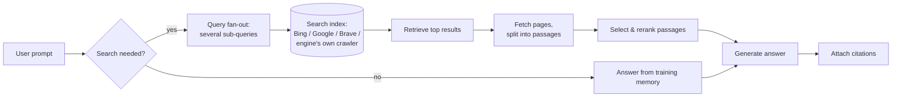

# 2. How answer engines decide what to say

Every optimisation in this handbook targets one stage of the pipeline below. Knowing which
stage you are acting on is the difference between AEO and guesswork.

## Stage by stage

**1. Search activation.** The model decides whether to search. Questions about recent
events, prices, local businesses, specific products or comparisons usually trigger search;
general knowledge questions often do not. When no search happens, only training memory
matters.

**2. Query fan-out.** Engines rewrite one prompt into several searches. Google documents
this for AI Overviews and AI Mode: "issuing multiple related searches across subtopics and
data sources" ([Google](https://developers.google.com/search/docs/appearance/ai-features)).
Microsoft's Bing Webmaster Tools now shows the *grounding queries* its AI used to find
cited pages: short, topical queries generated in the background, not what users typed.
**Implication:** you compete on the sub-questions (price, alternatives, "X vs Y",
limitations, use cases), not only the head query.

**3. Index.** Each engine leans on a different index (details in [engines/](../engines/README.md)):

| Engine | Main index for grounding |
|---|---|
| ChatGPT search | OpenAI's OAI-SearchBot index plus third-party providers (Bing has been the main partner) |
| Claude | Anthropic's Claude-SearchBot index plus a search provider (reported to be Brave) |
| Gemini, AI Overviews, AI Mode | Google Search's index (Googlebot) |
| Microsoft Copilot | Bing |
| Perplexity | Its own index (PerplexityBot) |

Low overlap between engines' cited sources is normal; commercial audits find little
overlap between, say, ChatGPT's and Perplexity's cited domains.

**4. Fetch and chunk.** Retrieved pages are fetched (sometimes from cache) and split into
passages. Most AI crawlers fetch **raw HTML and do not execute JavaScript** (the
[Vercel/MERJ study](https://vercel.com/blog/the-rise-of-the-ai-crawler) found none of the
major AI crawlers rendering JS; Google's crawling for Gemini does render). Content that
appears only after client-side rendering may never be seen.

**5. Select and rerank.** Passages compete on **relevance to the sub-query** first.
Controlled studies agree on this: models "rely heavily on the relevance of a website to the
query, while largely ignoring stylistic features" such as scientific references or a neutral
tone ([Wan, Wallace & Klein, ACL 2024](https://aclanthology.org/2024.acl-long.403)), and in
head-to-head tests topical relevance and list position were the strongest drivers of which
source is cited first ([Vishwakarma et al., 2026](https://arxiv.org/abs/2605.25517)).

**6. Generate and cite.** The model writes one answer and attaches a few citations. Engines
differ: Perplexity and Google cite more sources per answer; ChatGPT cites fewer but each
cited page shapes more of the answer ([Zhang et al., 2026](https://arxiv.org/abs/2604.25707)).
Citations are imperfect: earlier audits found many generated sentences not fully supported
by their citations ([Liu et al., 2023](https://arxiv.org/abs/2304.09848)), and news citations
are often wrong ([Tow Center, 2025](https://www.cjr.org/tow_center/we-compared-eight-ai-search-engines-theyre-all-bad-at-citing-news.php)).

## Biases you are competing with

| Bias | What it means for you | Evidence |
|---|---|---|
| **Position bias** | Sources earlier in the context are cited more | [Liu et al., "Lost in the Middle"](https://arxiv.org/abs/2307.03172); [Vishwakarma et al.](https://arxiv.org/abs/2605.25517); this repo's Experiment 2 |
| **Earned-media bias** | Engines favour third-party sources over brand-owned pages, more than Google search does | [Chen et al., 2025](https://arxiv.org/abs/2509.08919) |
| **Big-brand bias** | Well-known brands are recommended by default; niche players need corroboration | [Chen et al., 2025](https://arxiv.org/abs/2509.08919) |
| **Platform concentration** | Reddit, YouTube, Wikipedia and LinkedIn dominate citations in 2026 studies | [Peec AI, 30M citations, 2026](https://docs.peec.ai/research/most-cited-domains-in-ai-search) |
| **Run-to-run variance** | The same prompt rarely returns the same list; inclusion frequency is stable, order is not | SparkToro/Gumshoe study, Jan 2026 (via [Search Engine Journal](https://www.searchenginejournal.com/ai-recommendations-change-with-nearly-every-query-sparktoro/566242/)) |

## Training memory

When an engine answers without searching, it draws on what the model learned. You cannot
edit that directly. What shapes it over time:

- How often, how consistently and how credibly you are described across the public web
  (news, Wikipedia/Wikidata, reviews, forums, documentation, books, code).
- Whether training crawlers were allowed to read your own pages (GPTBot, ClaudeBot,
  Google-Extended, Applebot-Extended, CCBot). Blocking them is a legitimate rights decision,
  but it means future models learn about you only from others.

Changes show up only when a new model is trained, typically months later.

## Personalisation and context

Answers vary with location, language, conversation history, memory features and the
product surface (a consumer app with search and memory is not the same as a bare API
call). Measure in conditions that resemble your customers', and treat single screenshots as
anecdotes.

Next: [Technical access →](03-technical-access.md)
